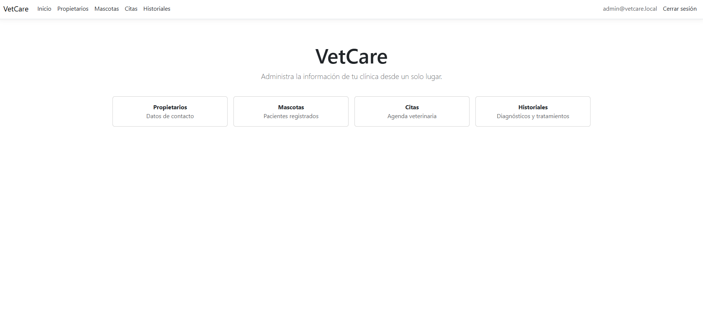

## 🐾 Veterinary Management System

VetCare is a veterinary management web application developed independently using C#, ASP.NET Core MVC, Entity Framework Core, and SQLite.

The application helps veterinary clinics manage pet owners, pets, appointments, and medical records through a centralized administrative dashboard.

### 📸 Application Preview

### 🚀 Key Features

- Pet owner and pet management
- Appointment scheduling and public online booking
- Medical records management
- Authentication and protected administrative access
- Real-time appointment notifications using SignalR
- Email confirmations and automated appointment reminders

### 🛠️ Technologies

- C# and ASP.NET Core MVC
- Entity Framework Core
- SQLite
- SignalR
- Razor Views, HTML, CSS, and JavaScript

---
